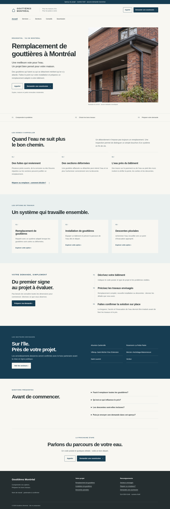
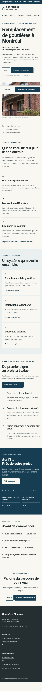

# Site Astro pour les demandes locales de remplacement de gouttières

Le dépôt vide reçoit un site statique en français québécois pour présenter le remplacement de gouttières à Montréal et préparer les demandes de soumission. L’accueil porte la recherche principale; les cinq pages complémentaires couvrent installation, descentes, secteurs envisagés, choix réparation/remplacement et soumission.

La configuration centralise le nom, les services, les secteurs et les coordonnées. Le mode aperçu affiche un numéro fictif, simule les demandes sans transfert de données et bloque l’indexation. Les appels et le formulaire ont des conditions d’activation distinctes; la conversion de soumission requiert une réponse réelle confirmée. Le README explique le transfert au partenaire, l’envoi, le suivi téléphonique, les canoniques et le sitemap public.

Les deux images originales sont intégrées : duplex en brique sur l’accueil et gouttière blanche sur la page des descentes pluviales. Les quatre fichiers WebP comprennent des recadrages mobiles; les originaux sont conservés dans le dépôt.

## Aperçu local

```sh
npm ci
npm run dev
# http://localhost:4321
```

Aucun déploiement ni domaine personnalisé nécessaire. Aperçu hors index par défaut.

## Validation

Compilation réussie, 4 tests de configuration et 8 tests Chromium réussis, contrôles clavier, liens, formulaire, absence d’envoi simulé et affichage de 320 à 1440 px. Voir `docs/validation.md` pour les limites.

## Captures

Captures de l’accueil avec les images originales optimisées :




Pour le corps GitHub de la PR, remplacer ces liens par les URL brutes des images du commit de la branche, dans `docs/`.
